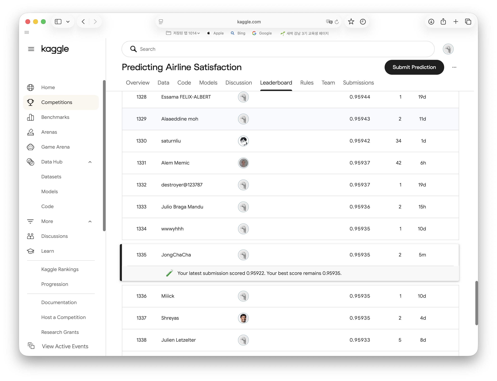

# 항공사 승객 만족도 예측 — 0.0013의 개선을 판정한 실험 프로토콜

> **Kaggle Playground Series S6E10** · 정형 데이터 이진 분류 · ROC-AUC
> **OOF AUC 0.95866 → 0.95994** (+0.00128) · **Public LB 0.95935** · 699,635 train / 299,844 test

SeSac AI 엔지니어링 과정 중간평가 과제입니다.

---

이미 OOF AUC **0.95866**인 LightGBM 베이스라인이 있었고 목표는 **0.9600**. 남은 여지는 0.0013이었습니다.

그런데 측정해보니 **Fold별 AUC의 표준편차가 0.00058** — 잡음과 목표 개선폭의 자릿수가 같았습니다. 그래서 이 프로젝트의 어려운 부분은 모델을 더 좋게 만드는 일이 아니라, **"지금 올라간 0.0005가 진짜 개선인가, 운인가"를 판정하는 일**이었습니다. 단계별 개선폭 0.0005는 잡음 0.00058과 거의 1:1이라, 한 번의 측정으로는 구분되지 않습니다. 작업의 상당 부분을 모델링이 아니라 실험 프로토콜 설계와 검증에 썼고, 그 결과 설계한 피처 4개 중 3개를 기각했습니다. **가장 많이 한 일은 추가가 아니라 기각입니다.**

| 단계 | OOF AUC | 기여 |
|---|---|---|
| 베이스라인 · LightGBM | 0.95866 | — |
| Step 1 · 피처 엔지니어링 | 0.95934 | +0.00068 |
| Step 2 · Optuna + 시드 앙상블 | 0.95986 | +0.00052 |
| **Step 3·4 · 모델 다변화 + 스태킹** | **0.95994** | +0.00008 |



> ### 📄 상세 기술 문서 → **[`chacha/README.md`](./chacha/README.md)**
>
> 실험 프로토콜(Fold 계약 · 4/5 Fold 판정 규칙), 단계별 측정값과 기각 근거,
> 전이 안전성 검증, Public LB 대조 결과까지 전부 여기에 있습니다.

---

## 구성

```
.
├── baseline[Lab].ipynb                      LightGBM 베이스라인 (출발점)
├── mlp_pytorch_baseline[Lab].ipynb          MLP 베이스라인 (스태킹 입력 중 하나)
└── chacha/                                  ← 이번 작업
    ├── 00_lgbm_baseline[Lab].ipynb          기준선 재현 + OOF 복원
    ├── 01_feature_engineering[Lab].ipynb    피처 4그룹 + 절제 실험
    ├── 02_hyperparameter_tuning[Lab].ipynb  Optuna + 다중 시드 검증
    ├── 03_model_diversification[Lab].ipynb  CatBoost / XGBoost + 다양성 분석
    ├── 04_stacking[Lab].ipynb               메타 모델 + 제출 파일
    ├── README.md                            ★ 상세 기술 문서
    ├── prd.md                               계획서 · 코드 감사 · 전체 실험 로그
    ├── run_nb.py                            노트북 배치 실행 래퍼
    └── outputs/reports/                     단계별 요약 · Optuna 탐색 로그
```

## 재현

**데이터와 대용량 예측 산출물은 저장소에 포함하지 않습니다** — 재현 가능하고 합계 약 310MB이기 때문입니다.

```bash
# 1. 데이터 — Kaggle 대회 페이지에서 받아 data/ 에 배치
#    https://www.kaggle.com/competitions/playground-series-s6e10

# 2. 의존성
uv sync

# 3. 순서대로 실행 (전체 약 2시간, CPU)
cd chacha
python run_nb.py '00_lgbm_baseline[Lab].ipynb'
python run_nb.py '01_feature_engineering[Lab].ipynb'
python run_nb.py '02_hyperparameter_tuning[Lab].ipynb'
python run_nb.py '03_model_diversification[Lab].ipynb'
python run_nb.py '04_stacking[Lab].ipynb'
```

각 노트북이 직전 단계의 산출물을 읽고 **Fold 계약을 검증**하므로 순서를 지켜야 합니다.

## 기술 스택

Python 3.13 · LightGBM 4.7 · XGBoost 3.4 · CatBoost 1.2 · Optuna 5.0 · scikit-learn 1.9 · pandas 3.0 · PyTorch 2.14
